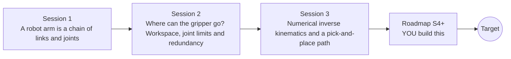

# openrobotarm

[](https://github.com/KrunalPanchal1995/openrobotarm/actions/workflows/ci.yml)   [](https://colab.research.google.com/github/KrunalPanchal1995/openrobotarm/blob/main/sessions/session-01/lesson.ipynb) [](https://krunalpanchal1995.github.io/openrobotarm/)

**Make a robot arm pick and place: from joint angles to the gripper and back, in three sessions.**

openrobotarm teaches forward and inverse kinematics for a planar robot arm, from cumulative joint angles to a damped least-squares solver that drives a pick-and-place path, using only Python and a browser.

- **Start from zero.** Session 1 needs only school trigonometry; no robotics or matrices are assumed.
- **See it move.** Every session ships a slider app that runs in the browser, with labelled graphs.
- **Know you got it right.** Each session ends with a checkpoint that prints PASS or FAIL against hand calculations and forward kinematics.
- **Build the missing half.** The repo stops at Session 3 on purpose; the roadmap shows the path to the Target.

[Target](#the-target) · [Who is this for](#who-is-this-for) · [Quick start](#quick-start) · [Sessions](#sessions) · [Roadmap](#roadmap) · [Contribute](#contribute) · [Explainer PDF](docs/explainer.pdf)

> **This repo is incomplete on purpose.** Sessions 1 to 3 are here and fully working. The finished Target below is a preview of what the community can build next. We show you the path, not the code. Sessions 4 and up are yours.

## The Target

A 3-link arm performs a pick-and-place while the picture shows what a simple solver hides: the region the gripper has swept so far, a manipulability ellipse at the gripper that flattens as the arm stretches towards a singularity, and the three joint-angle traces underneath. The arm picks at the left of the table, carries the part along a smooth path, and places it on the right, with the joints kept away from their limits. Your goal over the coming sessions: build that yourself, then take it into 3D.


*Target: a pick-and-place with swept workspace, manipulability ellipse and joint-angle traces*


*The Target at the moment of placing the part*


*Where the gripper can go, and how well it can move there (manipulability map)*

Try it live:

- [Math Visual Studio: matrices as transformations (Atlas S20)](https://krunalpanchal1995.github.io/studio/#atlas?ch=S20&ex=1)
- [Math Visual Studio: rigid bodies and kinematic pairs (Atlas S107)](https://krunalpanchal1995.github.io/studio/#atlas?ch=S107&ex=1)

How the Target was made is shown only as a path in [promo/roadmap.md](promo/roadmap.md).

## Who is this for
**higher secondary to advanced undergraduate (levels 4-6).** Topic area: Artificial Intelligence, Data Science and Robotics.

Prerequisites:

- Sine and cosine of an angle (school trigonometry).
- Python 3.10 or newer; if `python --version` works, you are ready. PRIMER.md explains the rest.
- No prior GitHub, robotics or linear algebra experience is needed; Session 3 explains the few matrix ideas it uses.

New to Python? Read [PRIMER.md](PRIMER.md) first (10 minutes).

## Quick start

No installation knowledge needed. You need [Git](https://git-scm.com/downloads) and [Python 3.10+](https://www.python.org/downloads/) (Windows: tick "Add Python to PATH"). On Mac and Linux type `python3` wherever this page says `python`.

```bash
git clone https://github.com/KrunalPanchal1995/openrobotarm.git
cd openrobotarm
python start.py 1
```

`start.py` creates a private environment, installs what is needed and runs Session 1 with its checkpoint. Next: `python start.py 2`, `python start.py 3`, or `python start.py test` to check everything. Only a checkpoint: `python start.py check 1`.

Four lines turn the idea of Session 1 into a result (they work as they are): Save it as `try.py` and run it with `python start.py run try.py` (this uses the private environment, where NumPy is installed):

```python
import numpy as np
q = np.radians([30, 40, -20])                   # three joint angles
c = np.cumsum(q)                                # each link's direction: 30, 70, 50 degrees
L = np.array([0.30, 0.25, 0.15])                # link lengths in metres
print(np.round([np.sum(L * np.cos(c)), np.sum(L * np.sin(c))], 3))   # -> [0.442 0.5  ]  the gripper position
```

Every session also opens in your browser with sliders (no install): [live apps](https://krunalpanchal1995.github.io/openrobotarm/). Or use the Colab badge above for the notebook.

## Sessions

| # | Session | Model level | Time | Live app |
|---|---|---|---|---|
| 1 | [A robot arm is a chain of links and joints](sessions/session-01/README.md) | Level 1: conceptual interactive model | 60 min | [open](https://krunalpanchal1995.github.io/openrobotarm/session-01/) |
| 2 | [Where can the gripper go? Workspace, joint limits and redundancy](sessions/session-02/README.md) | Level 2: mathematical engineering model | 80 min | [open](https://krunalpanchal1995.github.io/openrobotarm/session-02/) |
| 3 | [Numerical inverse kinematics and a pick-and-place path](sessions/session-03/README.md) | Level 3: simulation and validation | 90 min | [open](https://krunalpanchal1995.github.io/openrobotarm/session-03/) |

Each session follows the same six steps: A real-world problem, B concept and theory, C visual explanation, D interactive simulation, E worked example and experiment, F assessment and design challenge. Each ends with `checkpoint.py`, which prints `PASS` or `FAIL` against reference numbers. Session 3 also contains the real-world mini-project: **Program a pick-and-place that avoids a no-go zone**.

## Architecture



| Folder or file | What is inside |
|---|---|
| `sessions/` | three sessions: README (A-F), `lesson.py`, notebook, live app, exercises, activity sheet, checkpoint |
| `promo/` | the Target: media, live links, and the roadmap (path only) |
| `docs/` | `explainer.tex` and the built `explainer.pdf` |
| `tests/` | runs every lesson and checkpoint headless |
| `start.py` | one command to set up and run anything |
| `QUALITY.md`, `RUBRIC.md` | the quality checklist and the scoring rubric |
| `.github/` | CI, PDF build, Pages deploy, issue and PR templates |

## Roadmap

| Milestone | What you will build | Difficulty |
|---|---|---|
| Session 4: Whole-arm collision checking | A checker that tests every link of the arm, not just the gripper, against the no-go zone, and a planner that picks the route and the elbow choice. | intermediate |
| Session 5: Speed limits and time-optimal timing | A planner that stretches the move in time until no joint exceeds a speed limit. | intermediate |
| Session 6: Calibrate the link lengths | A program that recovers the true link lengths from measured gripper positions at several poses. | advanced |
| Session 7: A six-joint arm in 3D with orientation | Forward and numerical inverse kinematics for a six-joint arm that sets position and orientation. | advanced |
| Session 8: Animate the pick-and-place | A looping animation of pick, carry, place and return, exported as a GIF, with the swept workspace and joint traces. | advanced |

Full detail with a checkpoint per milestone: [promo/roadmap.md](promo/roadmap.md).

## Contribute
New to GitHub? Read [CONTRIBUTING.md](CONTRIBUTING.md); it starts from zero. Pick an issue labelled `good first issue`. Translations into Hindi, Telugu, Tamil and Malayalam are welcome.

<details>
<summary>Development</summary>

```bash
python start.py test        # runs every lesson and checkpoint
```
Lessons use `# %%` cell markers so they open as notebooks in VS Code. See [QUALITY.md](QUALITY.md) for the standard every session meets.
</details>

## License
MIT. See [LICENSE](LICENSE). Media in `promo/media` is (c) Krunal Panchal, CC BY 4.0.

## Acknowledgments
Part of the [PAN IIT OSS](https://hellofoss.tech-iitb.org/projects) open-source teaching collection, modelled on the structure of [openspline](https://github.com/openspline/openspline). Built on ideas from the Math Visual Studio at https://krunalpanchal1995.github.io/studio/.
