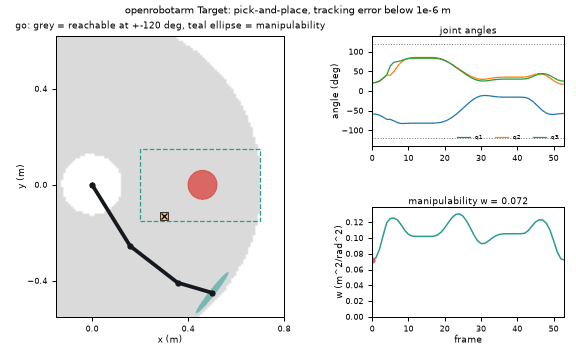
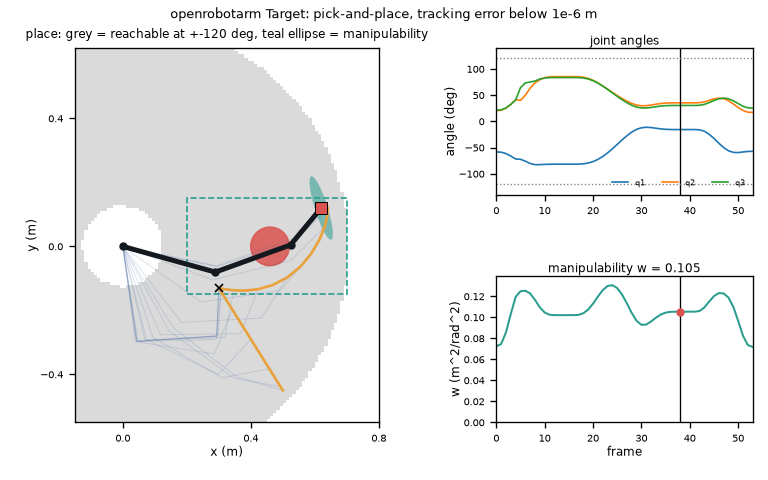
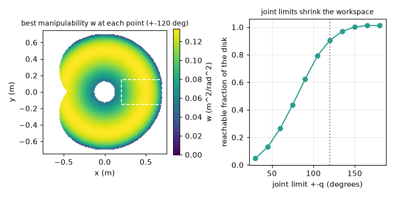

# What you are building toward

A 3-link arm performs a pick-and-place while the picture shows what a simple solver hides: the region the gripper has swept so far, a manipulability ellipse at the gripper that flattens as the arm stretches towards a singularity, and the three joint-angle traces underneath. The arm picks at the left of the table, carries the part along a smooth path, and places it on the right, with the joints kept away from their limits. Your goal over the coming sessions: build that yourself, then take it into 3D.

*Target: a pick-and-place with swept workspace, manipulability ellipse and joint-angle traces*

*The Target at the moment of placing the part*

*Where the gripper can go, and how well it can move there (manipulability map)*

These results come from a private reference build. The code is not published; the roadmap shows the path so you can build your own.

Live links:

- [Math Visual Studio: matrices as transformations (Atlas S20)](https://krunalpanchal1995.github.io/studio/#atlas?ch=S20&ex=1)
- [Math Visual Studio: rigid bodies and kinematic pairs (Atlas S107)](https://krunalpanchal1995.github.io/studio/#atlas?ch=S107&ex=1)
