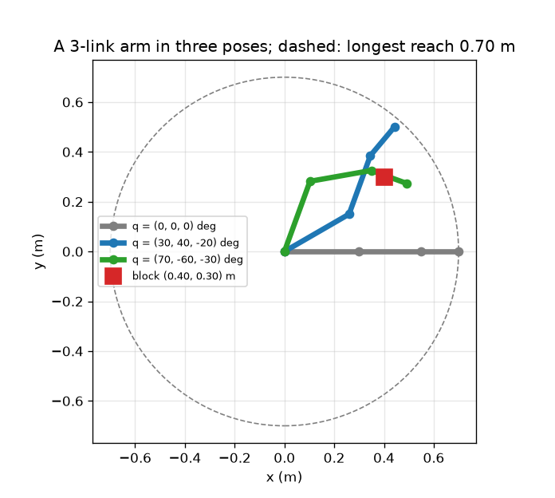
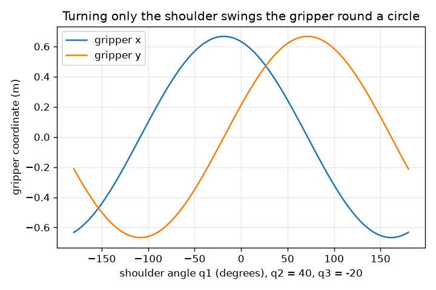

# Session 1: A robot arm is a chain of links and joints

*Level 1 (conceptual interactive model) · about 60 minutes · openrobotarm*

> This is a simplified educational model. It is not a validated design tool and must not be used for real structures, electrical installations, vehicles, industrial processes or medical decisions.

**Prerequisites**

- School trigonometry: sine and cosine.
- You have read PRIMER.md and run `python start.py 1` once.

**Learning objectives.** After this session you can:

- Describe a planar arm by its link lengths and joint angles.
- Explain why joint angles add up down the chain (cumulative angles).
- Compute the gripper position and tool angle from three joint angles, by hand and in Python.
- State the longest reach and decide whether a block can be touched.

## A. Real-world problem
A pick-and-place robot lifts a block from one spot and sets it down on another, hundreds of times an hour. Its motors only turn joints. Nobody can tell a motor 'go to x = 0.40, y = 0.30'; we must work out which joint angles put the gripper there. Before running the problem backwards, we must be able to run it forwards: given three joint angles, where does the gripper end up? Can a 3-link arm with links of 0.30 m, 0.25 m and 0.15 m touch a block 0.40 m across and 0.30 m up?

## B. Concept and theory
The arm is a chain: link 1 is fixed to the base at the origin by joint 1, link 2 is fixed to the end of link 1 by joint 2, and so on. Each joint angle is measured relative to the previous link, so a link's direction in the room is the running total of the joint angles up to it (its cumulative angle). Walking along the chain, each link adds its length times (cos, sin) of its cumulative angle, and the last point is the gripper. The tool angle, the direction the gripper points, is the sum of all joint angles. The gripper can never be farther from the base than the sum of the link lengths.

| Symbol | Meaning | Unit |
|---|---|---|
| q1, q2, q3 | joint angles, each relative to the previous link, counter-clockwise positive | degrees or radians |
| L1, L2, L3 | link lengths (0.30, 0.25, 0.15) | m |
| c1, c2, c3 | cumulative angles: direction of each link from the x axis | degrees or radians |
| (x, y) | gripper position | m |
| tool angle | direction the gripper points, q1 + q2 + q3 | degrees |

**Assumptions**

- The arm moves in one flat plane (looked at from above).
- Links are rigid and joints have zero size.
- The base is fixed at the origin (0, 0) and joints turn freely (limits come in Session 2).
- Angles are measured counter-clockwise from the x axis.

$$ c_k=q_1+q_2+\cdots+q_k $$

$$ x=\sum_{k=1}^{3}L_k\cos c_k,\qquad y=\sum_{k=1}^{3}L_k\sin c_k $$

$$ \text{tool angle}=c_3=q_1+q_2+q_3 $$

$$ \sqrt{x^2+y^2}\le L_1+L_2+L_3=0.70\ \text{m} $$

## C. Visual explanation
The first figure shows the arm in three poses in metres: stretched along x (gripper at (0.70, 0)), the pose (30, 40, -20) degrees with the gripper at (0.442, 0.500), and the pose (70, -60, -30) degrees with the gripper at (0.490, 0.274). The red square is the block and the dashed circle is the longest reach. The second figure turns only the shoulder with the other two joints fixed at 40 and -20 degrees: the gripper runs round a circle of radius 0.667 m, so x and y are a cosine and a sine of the shoulder angle, and x is largest, 0.667 m, at a shoulder angle of -18.5 degrees.

*Three poses of the 3-link arm in metres, the block and the longest reach.*

*Gripper x and y when only the shoulder turns: a cosine and a sine of radius 0.667 m.*

## D. Interactive simulation
Run the lesson (`python start.py 1`), then open the live app: [Session 1: a 3-link arm](https://krunalpanchal1995.github.io/openrobotarm/session-01/) (or `app.html` in this folder). Move the three sliders and watch the chain: the gripper follows all of them. Switch to the graph and see x and y when only the shoulder moves. Note how the readout shows the distance from the block.

**Challenge.** Put the gripper on the block at (0.40, 0.30) m, within 2 cm.

## E. Worked example and experiment
**Problem.** Find the gripper position, the tool angle and the distance from the base for q = (30, 40, -20) degrees with L = (0.30, 0.25, 0.15) m.

1. Cumulative angles: c1 = 30, c2 = 30 + 40 = 70, c3 = 70 - 20 = 50 degrees.
2. Link 1: 0.30 * (cos 30, sin 30) = 0.30 * (0.866, 0.500) = (0.2598, 0.1500) m.
3. Link 2: 0.25 * (cos 70, sin 70) = 0.25 * (0.3420, 0.9397) = (0.0855, 0.2349) m.
4. Link 3: 0.15 * (cos 50, sin 50) = 0.15 * (0.6428, 0.7660) = (0.0964, 0.1149) m.
5. Add the three: x = 0.2598 + 0.0855 + 0.0964 = 0.4417 m and y = 0.1500 + 0.2349 + 0.1149 = 0.4998 m. The tool angle is c3 = 50 degrees.
6. Distance from the base: sqrt(0.4417^2 + 0.4998^2) = 0.667 m, below the longest reach 0.70 m, as it must be.

**Answer.** The gripper is at (0.442, 0.500) m, pointing 50 degrees from the x axis, 0.667 m from the base.

**Experiment.** Cut three cardboard strips of 30, 25 and 15 cm and join them with pins at one end of a sheet of squared paper. Set the angles with a protractor (remember each angle is relative to the previous strip) and read the gripper position off the paper; expect agreement to about 5 mm. The differences come from pin thickness and protractor reading: the model has zero-size joints and perfectly rigid links, the cardboard does not.

## F. Assessment and design challenge
**Question type A: Conceptual.** Why is the tool angle q1 + q2 + q3, and not just q3? What would the gripper do if only joint 1 turned by 10 degrees?

Hint

Each joint angle is measured relative to the link before it.

Step-by-step solution

Joint 3 is measured relative to link 2, which itself points in the direction q1 + q2. So link 3 points at q1 + q2 + q3. If only joint 1 turns by 10 degrees, every link after it is carried along: the whole arm rotates rigidly by 10 degrees about the base, the tool angle increases by 10 degrees and the gripper moves round a circle centred on the base.

**Question type B: Numerical.** For q = (90, -90, 0) degrees find the gripper position. Is it on the block at (0.40, 0.30) m?

Hint

The cumulative angles are 90, 0 and 0 degrees.

Step-by-step solution

Link 1 points up: (0, 0.30). Link 2 (cumulative angle 0) points along x: (0.25, 0). Link 3 (cumulative angle 0): (0.15, 0). Sum: (0.40, 0.30) m, exactly the block. Check: the distance from the base is sqrt(0.40^2 + 0.30^2) = 0.50 m, below 0.70 m, so it is reachable.

**Question type C: Graph and simulation interpretation.** In the second figure, how large is the radius of the circle the gripper runs round, and at which shoulder angle is the gripper's x largest?

Hint

Set q1 = 0 to find the distance of the gripper from the base, then ask where that point lies on the circle.

Step-by-step solution

With q1 = 0 the gripper is at (0.632, 0.212) m, so its distance from the base is 0.667 m and that is the radius for every q1. The point is at angle atan2(0.212, 0.632) = 18.5 degrees from the x axis, so x is largest when q1 = -18.5 degrees, bringing it onto the x axis, where x = 0.667 m.

**Question type D: Design and optimisation challenge.** Design: a supplier sells 3-link arms with total link length 0.45, 0.60, 0.70 and 0.85 m. The block is 0.50 m from the base and you want at least 0.10 m of spare reach. Which arm do you choose, and what do you give up with a longer one?

Hint

Reach is limited by the total length; add the spare reach to the block distance.

Step-by-step solution

The arm must reach at least 0.50 + 0.10 = 0.60 m, which rules out 0.45 m. The smallest that qualifies is 0.60 m (0.70 and 0.85 also qualify). A longer arm reaches more but is heavier, needs bigger motors and, because a small joint error is multiplied by the distance, places the gripper less accurately. Assumption: the arm can be posed freely (no joint limits yet).

Score yourself with [RUBRIC.md](../../RUBRIC.md). Print the [activity sheet](activity_sheet.md) to work on paper.

## Common misconceptions
| Common misconception | What is actually true |
|---|---|
| Joint 3 is measured from the x axis. | Every joint angle is relative to the link before it; the direction of a link in the room is a running total. |
| The gripper can go anywhere inside the circle of radius 0.70 m by just choosing one angle. | Three angles are needed in general; one angle only moves the gripper round a circle. |
| Turning the shoulder changes the shape of the arm. | Turning only joint 1 turns the whole arm rigidly about the base; the shape is set by q2 and q3. |

## Glossary
- **link**: a rigid bar of the arm between two joints
- **joint**: a pivot where one link turns relative to another, driven by a motor
- **gripper (end effector)**: the tool at the end of the chain that holds the part
- **cumulative angle**: the running total of joint angles; the direction of a link in the room
- **forward kinematics**: finding the gripper position from the joint angles
- **reach**: the distance from the base to the gripper

## Finish
1. Do the three coding tasks in [exercises.md](exercises.md).
2. Run `python start.py 1` again after your changes. It ends with the checkpoint; when it prints `PASS`, you are done. (Checkpoint only: `python start.py check 1`.)

Next: [Session 2](../session-02/README.md)
