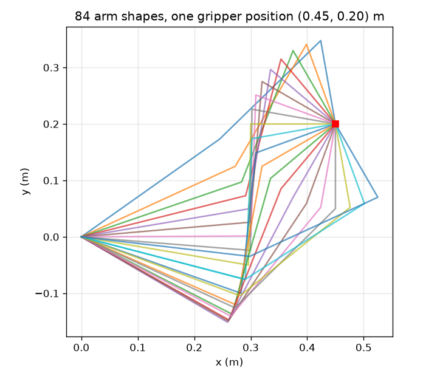
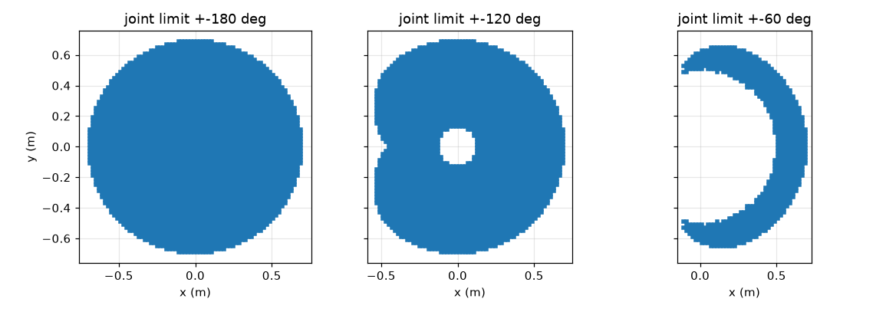

# Session 2: Where can the gripper go? Workspace, joint limits and redundancy

*Level 2 (mathematical engineering model) · about 80 minutes · openrobotarm*

> This is a simplified educational model. It is not a validated design tool and must not be used for real structures, electrical installations, vehicles, industrial processes or medical decisions.

**Prerequisites**

- Session 1: cumulative angles and the gripper position.
- The law of cosines is helpful but is explained in Section B.

**Learning objectives.** After this session you can:

- Describe the workspace of two links as a ring and measure an area by sampling a grid.
- Explain how a third link and the tool direction fill the workspace, and how joint limits cut it.
- Compute the reachable fraction of the workspace for given joint limits.
- Explain redundancy: one target, many arm shapes.
- Choose link lengths and joint limits so a work table is fully reachable.

## A. Real-world problem
Before buying or building a pick-and-place arm you must ask whether it can reach every spot on your work table. The answer depends on the link lengths, on how far each motor may turn (the joint limits), and on whether the gripper's direction matters. A 3-link arm has one more joint than a point in the plane needs, so a given spot can be reached in many ways. How much of the circle around the base can the gripper really reach if every joint is limited to 120 degrees either way? And can a 0.5 m x 0.3 m table 0.20 m in front of the base be covered?

## B. Concept and theory
Take the two-link arm first. Its distance from the base can be anything from |L1 - L2| to L1 + L2, so the reachable region is a ring (annulus) of area pi (R_out^2 - R_in^2) = 4 pi L1 L2. For three links, ask for the gripper to point along a chosen direction phi: then the wrist, the end of link 2, must sit at the target minus L3 (cos phi, sin phi), and the two-link rule applies to the wrist. For each wrist position the law of cosines gives q2 up to a sign (elbow up or down), then q1, and finally q3 = phi - q1 - q2. A point is reachable if some phi, and some elbow choice, gives joint angles that all satisfy |q| <= the joint limit. We measure areas by sampling: lay a grid of cells, test the centre of each cell, and multiply the count by the area of a cell. The extra joint gives redundancy: for the same target, every allowed phi is a different arm shape.

| Symbol | Meaning | Unit |
|---|---|---|
| L1, L2, L3 | link lengths (0.30, 0.25, 0.15) | m |
| phi | tool direction: the angle the gripper points at | degrees or radians |
| w | wrist position, target minus L3 (cos phi, sin phi) | m |
| q_max | joint limit: every joint must satisfy \|q_i\| <= q_max | degrees |
| fraction | reachable cells divided by cells in the full disk | no unit |
| A | area of the reachable region | m^2 |

**Assumptions**

- The arm is planar with rigid links and zero-size joints.
- Every joint has the same symmetric limit +-q_max, measured from the straight-ahead pose.
- The tool direction is sampled in 5 degree steps and the grid cell is 0.02 m, so areas are approximate to about 1 percent.
- Collisions between links, and with the table, are ignored.

$$ |L_1-L_2|\le\sqrt{x^2+y^2}\le L_1+L_2,\qquad A=\pi\big((L_1+L_2)^2-(L_1-L_2)^2\big)=4\pi L_1L_2 $$

$$ \mathbf w=\mathbf p-L_3(\cos\varphi,\ \sin\varphi) $$

$$ \cos q_2=\frac{|\mathbf w|^2-L_1^2-L_2^2}{2L_1L_2},\qquad q_1=\operatorname{atan2}(w_y,w_x)-\operatorname{atan2}(L_2\sin q_2,\ L_1+L_2\cos q_2) $$

$$ q_3=\varphi-q_1-q_2,\qquad |q_i|\le q_{\max}\ (i=1,2,3) $$

$$ A\approx N_{\text{reachable}}\,\Delta^2\quad(\Delta=\text{cell size}) $$

## C. Visual explanation
The first figure draws the reachable cells for three joint limits: with +-180 degrees the whole disk of radius 0.70 m is filled (1.000 of it), with +-120 degrees 0.892 of it, and with +-60 degrees only 0.246 of it, a thin region in front of the arm. The second figure shows many arm shapes that all put the gripper on the same target (0.45, 0.20) m: that is redundancy. The slider app plots the reachable fraction against the joint limit and marks the 90 percent line.

*84 arm shapes that all put the gripper on the same point (0.45, 0.20) m.*

*Reachable cells of the 3-link arm for joint limits of 180, 120 and 60 degrees.*

## D. Interactive simulation
Run the lesson (`python start.py 2`), then open the live app: [Session 2: workspace and joint limits](https://krunalpanchal1995.github.io/openrobotarm/session-02/) (or `app.html` in this folder). Slide the joint limit and watch grey cells (lost to the limits) appear around the edge of the disk, then lengthen the third link and see how the lost region changes. Switch to the graph to read the fraction.

**Challenge.** Keep the joint limit at 120 degrees and make the third link long enough that at least 90 percent of the disk is reachable.

## E. Worked example and experiment
**Problem.** Find the joint angles that put the gripper at (0.45, 0.20) m pointing along +x (phi = 0), for L = (0.30, 0.25, 0.15) m. Are they within +-120 degrees?

1. Wrist: w = (0.45, 0.20) - 0.15 * (1, 0) = (0.30, 0.20) m, so |w|^2 = 0.13.
2. cos q2 = (0.13 - 0.0900 - 0.0625) / (2 * 0.30 * 0.25) = -0.0225 / 0.15 = -0.15, so q2 = +-98.63 degrees.
3. For q2 = +98.63: atan2(0.20, 0.30) = 33.69 degrees and atan2(0.25 * 0.9887, 0.30 + 0.25 * (-0.15)) = atan2(0.2472, 0.2625) = 43.28 degrees, so q1 = 33.69 - 43.28 = -9.59 degrees.
4. Then q3 = 0 - (-9.59) - 98.63 = -89.04 degrees. The other elbow choice gives (77.0, -98.6, 21.7) degrees in the same way.
5. All six angles have magnitude below 120 degrees, so both shapes are allowed. Check: both put the gripper at (0.45, 0.20) m with tool angle 0.

**Answer.** Two arm shapes: (-9.6, 98.6, -89.0) degrees and (77.0, -98.6, 21.7) degrees; both within +-120 degrees.

**Experiment.** Pin your cardboard arm (30, 25 and 15 cm) to a sheet and tape a marker at (45 cm, 20 cm). Pose it with the first set of angles and then with the second, with the last strip along the x axis: the gripper should touch the marker both times. Then try to reach a point 75 cm away: you cannot. A real robot would also stop at its joint limits and would avoid collisions between links; the model ignores both, which is why a real robot's usable workspace is smaller than the model's.

## F. Assessment and design challenge
**Question type A: Conceptual.** A two-link arm with L1 = 0.30 m and L2 = 0.25 m has a hole of radius 0.05 m in its workspace. Why does adding a 0.15 m third link remove the hole, if the gripper's direction is free?

Hint

Where can the wrist be, and how far can the gripper be from the wrist?

Step-by-step solution

The wrist can be anywhere in the ring from 0.05 m to 0.55 m. The gripper is up to 0.15 m from the wrist in any direction (the direction is free). The hole has radius 0.05 m, which is smaller than 0.15 m, so every point of the hole is within 0.15 m of some wrist position in the ring. The hole disappears and the workspace is the full disk of radius 0.70 m. If the direction were fixed, the workspace would be the same ring shifted by 0.15 m, with the hole still there.

**Question type B: Numerical.** Compute the reachable area of a two-link arm with L1 = 0.40 m and L2 = 0.20 m, and its smallest and largest radius.

Hint

Use area = 4 pi L1 L2 and the radii |L1 - L2| and L1 + L2.

Step-by-step solution

Smallest radius |0.40 - 0.20| = 0.20 m, largest 0.60 m. Area = 4 pi * 0.40 * 0.20 = 1.005 m^2. Check: pi (0.60^2 - 0.20^2) = pi * 0.32 = 1.005 m^2. A sanity check: the area must be smaller than the full disk pi * 0.60^2 = 1.131 m^2, and it is.

**Question type C: Graph and simulation interpretation.** From the graph of reachable fraction against joint limit, with L = (0.30, 0.25, 0.15) m, how much of the disk is lost at +-90 degrees, and what is the smallest 5 degree step of the limit that keeps 90 percent?

Hint

Read the curve at 90 and where it crosses the red line; the checkpoint prints the values.

Step-by-step solution

At +-90 degrees the reachable fraction is 0.613, so 0.387 of the disk is lost. The curve crosses 0.9 between 120 degrees (0.892) and 125 degrees (0.918), so the smallest 5 degree step is 125 degrees. The curve is steep at small limits and flattens near 180 degrees, so the last few degrees of motor range buy little.

**Question type D: Design and optimisation challenge.** Design: a work table 0.5 m x 0.3 m has its short edge 0.20 m in front of the base, centred on it. Choose L3 (keeping L1 = 0.30 m and L2 = 0.25 m) and the smallest joint limit in 5 degree steps so every point of the table is reachable. Justify it.

Hint

The farthest points are the far corners at (0.70, +-0.15) m; their distance must not exceed the total link length.

Step-by-step solution

The far corners are at sqrt(0.70^2 + 0.15^2) = 0.716 m, so the total length must be at least 0.716 m, i.e. L3 >= 0.166 m. With L3 = 0.15 m (total 0.70 m) only 0.956 of the table grid points are reachable; with L3 = 0.17 m (total 0.72 m) all of them are. The table is not close to the base (0.20 m), so the inner hole does not matter. Joint limits: with L3 = 0.17 m the table is fully reached at +-105 degrees but only 0.974 at +-100 and 0.839 at +-90, so choose +-105 degrees, and add margin (for example +-120) in practice. Trade-off: a longer last link gives a little more reach but adds weight at the end of the arm.

Score yourself with [RUBRIC.md](../../RUBRIC.md). Print the [activity sheet](activity_sheet.md) to work on paper.

## Common misconceptions
| Common misconception | What is actually true |
|---|---|
| A 3-link arm can reach any point inside its longest-reach circle in every tool direction. | Each tool direction has its own workspace (a ring shifted by L3); only if the direction is free is the whole disk reachable. |
| If both joints can turn through a wide range, every point inside the reach circle is reachable. | Joint limits cut off regions, especially behind the base; reachability depends on the angle ranges as well as the lengths. |
| There is one set of joint angles for each target. | A 3-link arm is redundant for a position target: there is a whole family of shapes, one per tool direction (and two elbow choices). |

## Glossary
- **workspace**: the set of positions the gripper can reach
- **annulus**: a ring: the region between two circles with the same centre
- **joint limit**: the largest angle a joint is allowed to turn from straight ahead
- **redundancy**: having more joints than the task needs, so there are many solutions
- **elbow up and elbow down**: the two joint solutions found from the sign of q2
- **grid sampling**: measuring an area by counting grid cells that satisfy a test

## Finish
1. Do the three coding tasks in [exercises.md](exercises.md).
2. Run `python start.py 2` again after your changes. It ends with the checkpoint; when it prints `PASS`, you are done. (Checkpoint only: `python start.py check 2`.)

Next: [Session 3](../session-03/README.md)
