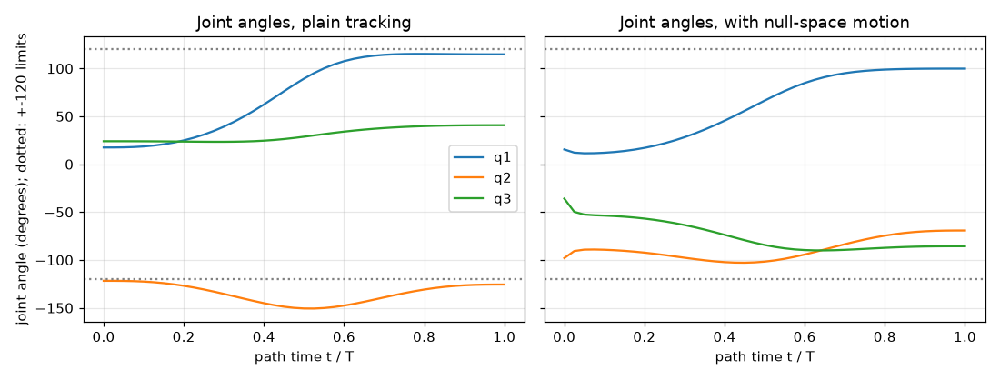
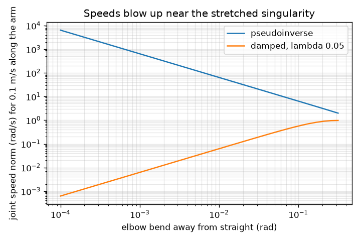

# Session 3: Numerical inverse kinematics and a pick-and-place path

*Level 3 (simulation and validation) · about 90 minutes · openrobotarm*

> This is a simplified educational model. It is not a validated design tool and must not be used for real structures, electrical installations, vehicles, industrial processes or medical decisions.

**Prerequisites**

- Session 1: forward kinematics with cumulative angles.
- Session 2: workspace, joint limits and redundancy.
- A first idea of a 2 x 3 matrix times a vector; the rest is explained in Section B.

**Learning objectives.** After this session you can:

- Derive the Jacobian of the planar chain and verify it against finite differences.
- Solve inverse kinematics by damped least squares and explain why damping is needed near singularities.
- Show that the smallest singular value goes to zero at a stretched arm and compute the manipulability.
- Follow a straight-line path with smooth timing, check it against forward kinematics, and keep joints away from their limits in the null space.
- Explain failure cases: an unreachable target, elbow flips and joint limits.

## A. Real-world problem
A pick-and-place robot must follow a path: lift the part here, slide it there. The path is a list of gripper positions; the motors need joint angles for every one. For our 3-joint arm there is no single formula (one joint is spare), so the computer finds the angles by iteration, like Newton's method. What goes wrong when the arm is fully stretched, when the target is out of reach, or when a joint hits its limit? And how accurate is the result if a link is 1 mm longer than we think?

## B. Concept and theory
A small turn dq_i of joint i moves the gripper by the i-th column of the Jacobian J, a 2 x 3 matrix, so a small change of all joints moves the gripper by J dq. If the gripper is off target by e, we want J dq = e. With three unknowns and two equations there are many answers; the pseudoinverse J^T (J J^T)^-1 e picks the smallest. Close to a singularity J J^T is nearly not invertible and the answer blows up, so we add a damping term: dq = J^T (J J^T + lambda^2 I)^-1 e (damped least squares). We repeat q = q + dq until e is tiny, capping the step at 0.1 rad per joint so a bad start cannot make the iteration jump. The singular values s1 >= s2 of J say how easily the gripper moves in its best and worst directions; the manipulability w = s1 s2 = sqrt(det(J J^T)) is zero when the arm is stretched, because J then has only one non-zero row. Because the arm has a spare joint, motion in the null space, dq = (I - J+ J) z, changes the shape of the arm and leaves the gripper where it is; we use it to push joints away from their limits. A straight-line path is timed with the quintic s(t) = 10 t^3 - 15 t^4 + 6 t^5, which starts and ends with zero speed and zero acceleration.

| Symbol | Meaning | Unit |
|---|---|---|
| J | Jacobian: 2 x 3 matrix, metres of gripper motion per radian of each joint | m/rad |
| e | position error, target minus current gripper position | m |
| lambda | damping factor | m/rad |
| s1, s2 | singular values of J | m/rad |
| w | manipulability s1 s2 | m^2/rad^2 |
| N | null-space projector I - J+ J | no unit |
| s(t) | path timing, 0 to 1 as t goes from 0 to 1 | no unit |

**Assumptions**

- Planar arm, rigid links, link lengths exactly as stated, joints turn freely unless a limit is stated.
- Joint limits are applied by clipping the angles; this is crude but shows the effect.
- Only the gripper position is controlled, not its direction; the path is checked for the gripper only, links may collide with anything.
- This is an educational model, not a program for a real robot; real controllers also limit speed, acceleration and force.

$$ J=\begin{pmatrix}-\sum_{k\ge1}L_k\sin c_k & -\sum_{k\ge2}L_k\sin c_k & -L_3\sin c_3\\ \ \ \sum_{k\ge1}L_k\cos c_k & \ \ \sum_{k\ge2}L_k\cos c_k & \ \ L_3\cos c_3\end{pmatrix},\qquad \Delta\mathbf p\approx J\,\Delta\mathbf q $$

$$ \Delta\mathbf q=J^{\mathsf T}\big(JJ^{\mathsf T}+\lambda^2I\big)^{-1}\mathbf e,\qquad \mathbf q\leftarrow\mathbf q+\Delta\mathbf q $$

$$ w=s_1s_2=\sqrt{\det\!\big(JJ^{\mathsf T}\big)} $$

$$ \Delta\mathbf q=J^{+}\mathbf e+\big(I-J^{+}J\big)\,k\,(\mathbf q_{\text{pref}}-\mathbf q),\qquad J^{+}=J^{\mathsf T}\big(JJ^{\mathsf T}+\lambda^2I\big)^{-1} $$

$$ s(t)=10t^3-15t^4+6t^5,\qquad \mathbf p(t)=\mathbf a+s(t)\,(\mathbf b-\mathbf a) $$

## C. Visual explanation
The first figure shows the three joint angles along a 0.60 m straight path in 41 steps: on the left plain tracking from one elbow choice swings a joint out to 150.7 degrees, beyond the dotted 120 degree limits; on the right the null-space motion keeps every joint within 102.8 degrees with the same gripper path. The second figure is a log-log plot of the joint speed needed for 0.1 m/s along the arm as the elbow bends away from straight: the pseudoinverse needs 6.4, 64 and 640 rad/s for bends of 0.1, 0.01 and 0.001 rad, a straight line of slope -1, while the damped solver stays below 0.6 rad/s. The slider app shows the manipulability ellipse at the gripper and the error shrinking by a factor of ten or more per iteration at the end.

*Joint angles along a 0.60 m straight path: plain tracking (left) and with null-space motion (right); dotted lines are the 120 degree limits.*

*Joint speed needed for 0.1 m/s along the arm: the pseudoinverse blows up near the stretched pose, the damped solver does not.*

## D. Interactive simulation
Run the lesson (`python start.py 3`), then open the live app: [Session 3: numerical inverse kinematics](https://krunalpanchal1995.github.io/openrobotarm/session-03/) (or `app.html` in this folder). Drag the target and watch the arm follow; the ellipse flattens as the arm stretches. Move the target outside the dashed circle and read the final error. Lower the joint limit and see the arm stop short. Raise the damping and watch the iteration slow down.

**Challenge.** Place the target outside the arm's longest reach, farther than 0.75 m from the base, and read the final error.

## E. Worked example and experiment
**Problem.** Reach the target (0.45, 0.20) m from the start q = (0.3, 0.3, 0.3) rad, lambda = 0.01. Trace the error, and compare the first step with the cap.

1. Forward kinematics of the start: (0.586, 0.347) m, so the error is e = (-0.136, -0.147) m and |e| = 0.2006 m.
2. The raw damped step is dq = (-1.28, 1.56, 1.50) rad: far too large for a linear model, so it is scaled so that the largest joint change is 0.1 rad. The error becomes 0.1861 m.
3. Iterate: the error falls slowly at first while the steps are capped (0.168 m after 2 iterations, 0.091 m after 5), then very fast once the linear model is accurate.
4. After 8 iterations the error is 4.3e-4 m, after 9 it is 9.5e-7 m and after 10 it is 1.9e-9 m: each step squares the error, which is Newton-style convergence.
5. The iteration stops after 11 iterations with error below 1e-9 m, at q = (-21.0, 60.7, 59.0) degrees. Forward kinematics confirms the gripper is at (0.45, 0.20) m.

**Answer.** The solver reaches (0.45, 0.20) m in 11 iterations; the error goes 0.2006, 0.1861, ..., 4.3e-4, 9.5e-7, 1.9e-9 m.

**Experiment.** On a real arm, command the angles from the solver and measure the gripper position with a ruler or a camera. Expect an error of a few millimetres, not 1e-9 m: link lengths are not exact (a 1 mm error in any one link moves the gripper by 1 mm, and 1 mm in all three moves it by up to 3 mm), joints have backlash and the base is not perfectly level. The model is exact; the machine is not. Calibration measures the real lengths and corrects them.

## Real-world application and mini-project: Program a pick-and-place that avoids a no-go zone
A part must move from the pick position (0.40, -0.20) m to the place position (0.40, 0.20) m on a table. A fixture, a disc of radius 0.06 m centred at (0.40, 0), sits exactly between them: the gripper must not enter it. The straight line between pick and place passes through its centre. Use `line_path` and `track_path` from Session 3 to route the gripper via one waypoint beside the zone, with quintic timing on each leg and joint limits of 120 degrees. Find the smallest sideways offset of the waypoint (in steps of 0.01 m) for which the gripper path keeps out of the zone. The zone applies to the gripper only; assume the links pass above the fixture.

**Deliverable:** A script that, for each offset from 0.01 m to 0.20 m, prints the smallest distance of the gripper path from the zone centre, the largest end-effector error against forward kinematics, and the largest joint angle in degrees; names the smallest passing offset; and saves a picture of the table, the zone and the chosen route.

**Success looks like:** The smallest passing offset is reported, the end-effector error is below 1e-6 m everywhere, every joint stays within 120 degrees, and the gripper path stays more than 0.06 m from the zone centre.

## F. Assessment and design challenge
**Question type A: Conceptual.** Why can a pure pseudoinverse demand enormous joint speeds near a fully stretched arm, and how does damping fix this? What does damping cost?

Hint

Think of the smallest singular value and the size of 1 / s2.

Step-by-step solution

At the stretched pose J has rank 1: the gripper cannot move along the arm at all. Just off it, the smallest singular value s2 is tiny, and the pseudoinverse divides by it, so a request to move along the arm gives joint speeds of about speed / s2 (6.4 rad/s for a 0.1 m/s request at a bend of 0.1 rad, 640 rad/s at 0.001 rad). Damping replaces 1/s2 by s2 / (s2^2 + lambda^2), which never exceeds 1 / (2 lambda). The cost: the gripper no longer follows the request exactly in the weak direction (it moves a little less than asked), and convergence is slower.

**Question type B: Numerical.** Write the Jacobian of the stretched arm (all angles 0) with L = (0.30, 0.25, 0.15) m, and find its rank, its singular values and the manipulability.

Hint

With all angles 0 every sine is 0 and every cosine is 1; the columns are sums of lengths from joint i onwards.

Step-by-step solution

Row 1 (x) is -sum L_k sin c_k = 0 in all columns. Row 2 (y) is sum from i of L_k cos c_k = (0.70, 0.40, 0.15). So J = [[0, 0, 0], [0.70, 0.40, 0.15]], rank 1. The singular values are sqrt(0.70^2 + 0.40^2 + 0.15^2) = 0.82 m/rad and 0, so the manipulability is 0. Units: m/rad for J; the zero says the gripper cannot move along the arm.

**Question type C: Graph and simulation interpretation.** In the log-log figure, what is the slope of the pseudoinverse line and what does it mean for the speed when the bend is ten times smaller? What does the damped line do?

Hint

Compare 6.4, 64 and 640 rad/s for bends of 0.1, 0.01, 0.001 rad.

Step-by-step solution

The line has slope -1: each time the bend is ten times smaller, the speed is ten times larger (6.4, 64, 640 rad/s). Speed is about 0.1 m/s divided by the smallest singular value, which is proportional to the bend. The damped line is nearly flat and tiny (0.57, 0.06, 0.01 rad/s for lambda = 0.05) because damping stops dividing by s2; it does not demand motion that the arm cannot make.

**Question type D: Design and optimisation challenge.** Design: plain tracking of the path from (0.25, -0.30) m to (0.25, 0.30) m (a start with q2 near -122 degrees) swings a joint to 150.7 degrees, but the motors stop at 120 degrees. Give two ways to fix it, with numbers, and one trade-off.

Hint

One fix is to start from the other elbow choice; the other uses the spare joint with a null-space term.

Step-by-step solution

(1) Start from the other elbow choice (from the start q = (0.3, 0.3, 0.3) rad): plain tracking then keeps every joint below 99.5 degrees. (2) Keep the start, but add a null-space term k (q_pref - q) with q_pref = 0 and k = 0.1: the largest joint angle drops from 150.7 to 102.8 degrees with the same gripper path (error below 1e-6 m). Trade-off: the null-space motion moves the joints more per step (more joint speed) and shapes only joints that have slack; clipping alone cannot fix a path that the limits make impossible, so the target and path must be reachable within the limits to begin with.

Score yourself with [RUBRIC.md](../../RUBRIC.md). Print the [activity sheet](activity_sheet.md) to work on paper.

## Common misconceptions
| Common misconception | What is actually true |
|---|---|
| Inverse kinematics has one answer for each target. | A redundant arm has a whole family of answers, and even a two-link arm has two (elbow up and down); a numerical solver finds the one near its starting guess. |
| The iteration always reaches the target if it is close enough to the arm. | If a target is outside the reach, or needs a joint beyond its limit, the iteration stops at the nearest point it can get to; the error does not go to zero. |
| Damping is only a trick to make code not crash. | It is a deliberate trade: accuracy in the weak direction for bounded joint speeds near singularities. |
| Cold-starting the solver at each point of a path is as good as warm-starting. | Different starts can land on different arm shapes; a path needs each solution close to the previous one, otherwise the joints jump. |

## Glossary
- **Jacobian**: the matrix that turns small joint motions into small gripper motions
- **singularity**: a pose where the Jacobian loses rank and the gripper cannot move in some direction
- **singular value**: how strongly the Jacobian stretches motion in one special direction
- **manipulability**: the product of the singular values; zero at a singularity
- **damped least squares**: an inverse that adds lambda squared to keep the answer bounded near singularities
- **null space**: joint motions that leave the gripper in place; they change only the arm's shape
- **quintic timing**: a smooth start-to-end profile with zero speed and acceleration at both ends
- **warm start**: starting the solver from the previous solution

## Finish
1. Do the three coding tasks in [exercises.md](exercises.md).
2. Run `python start.py 3` again after your changes. It ends with the checkpoint; when it prints `PASS`, you are done. (Checkpoint only: `python start.py check 3`.)

Next: the [roadmap](../../promo/roadmap.md). Session 4 is yours to build.
